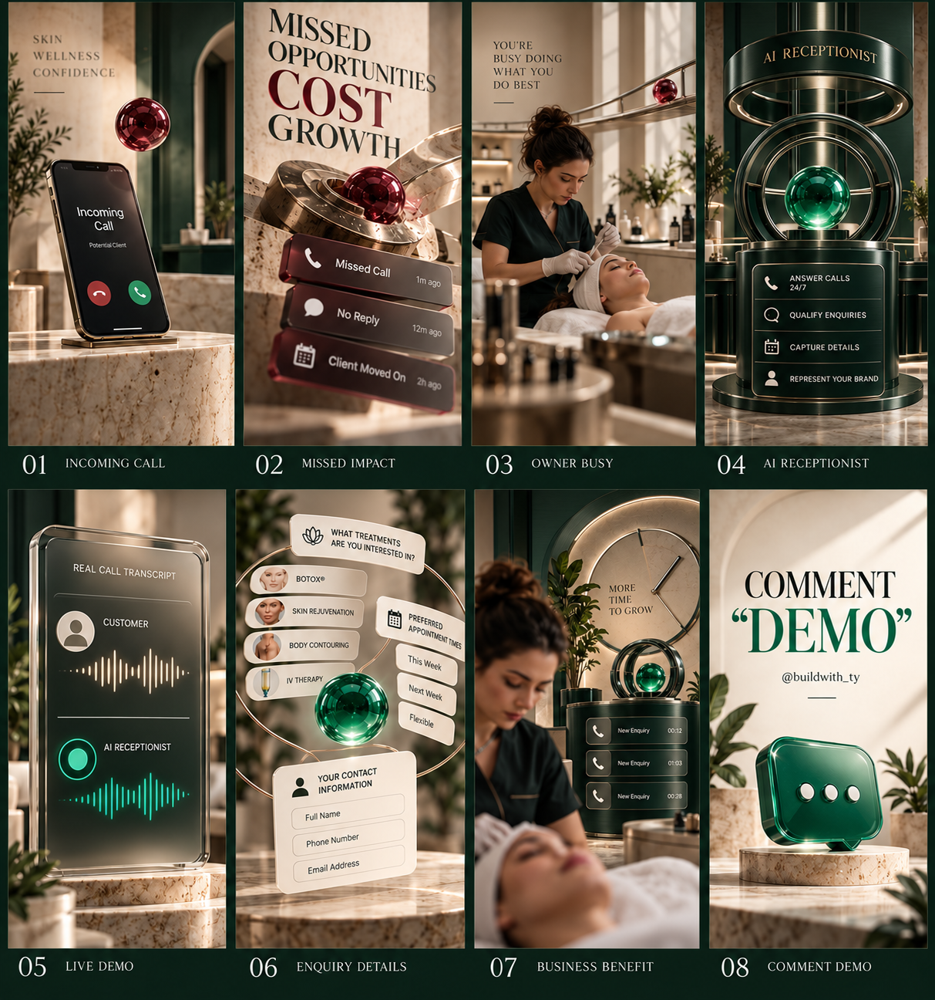

# AI Receptionist — Google Flow Storyboard

An original premium 3D motion direction for a vertical AI receptionist Reel. The concept follows a burgundy incoming-call orb through a medspa environment before it transforms into an emerald AI-response signal.

## Preview

[View the full storyboard contact sheet](storyboard-contact-sheet.png)

## Download

[Download the complete storyboard package](ai-receptionist-flow-storyboard.zip)

The ZIP contains the contact sheet, eight individual keyframes, and the detailed Google Flow direction and scene prompts.

## Files

1. [`01-incoming-call.png`](01-incoming-call.png)
2. [`02-missed-impact.png`](02-missed-impact.png)
3. [`03-owner-busy.png`](03-owner-busy.png)
4. [`04-ai-receptionist.png`](04-ai-receptionist.png)
5. [`05-live-demo.png`](05-live-demo.png)
6. [`06-enquiry-details.png`](06-enquiry-details.png)
7. [`07-business-benefit.png`](07-business-benefit.png)
8. [`08-comment-demo.png`](08-comment-demo.png)
9. [`storyboard-direction.md`](storyboard-direction.md) — production direction and prompts

No final video has been rendered in this package.
